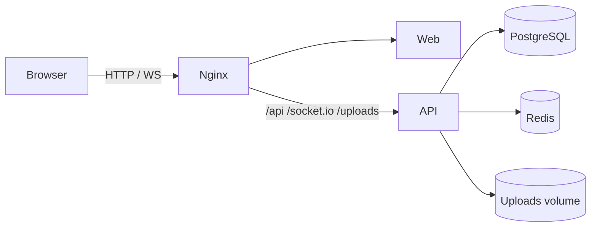

# Chat App

[](https://github.com/NimaM048/chat_app/actions/workflows/ci.yml)
[](LICENSE)
[](.nvmrc)

Telegram-inspired real-time messaging platform built as a **resume-grade full-stack project**.

## Highlights
- NestJS modular API with JWT auth, Prisma, Redis, Socket.IO
- React + Vite UI with chat list, bubbles, typing, seen, reply/pin/forward, emoji, file & voice
- Docker Compose production stack: Postgres + Redis + API + Web + Nginx
- Swagger docs, request IDs, health checks, Jest/Vitest/Playwright tests

## Architecture



**Why this stack**

| Choice | Reason |
|--------|--------|
| Socket.IO | Rooms, reconnect, ack-friendly real-time chat |
| Redis | Presence + rate limiting (in-memory fallback for local demo) |
| Prisma + PostgreSQL | Typed schema, migrations, production defaults |
| REST send + socket broadcast | Reliable delivery even when WS ack is flaky |
| Nginx | Single entrypoint, static assets, WS upgrade |

## Quick Start

### Local (no Docker)

```bash
npm install
npm run dev
```

- Web: http://localhost:5173
- API: http://localhost:3000/api/v1
- Swagger: http://localhost:3000/api/docs
- WebSocket: namespace `/ws`

Uses embedded PostgreSQL (UTF-8) for the API when Docker is unavailable.

### Full Docker stack

```bash
# optional: create .env with JWT secrets
docker compose up --build -d
```

Open http://localhost

Services: `nginx` (80), `web`, `api`, `postgres`, `redis`.

Seed demo users (against running API DB):

```bash
npm run seed -w @chat-app/api
```

Demo accounts:

- `alice` / `StrongPass123!`
- `bob` / `StrongPass123!`

## Feature Map

| Phase | Features |
|-------|----------|
| 1 | Auth, Telegram shell, dark/light |
| 2 | DM chat, realtime, typing, seen, presence |
| 3 | Reply, pin, forward, emoji, context menu |
| 4 | File/image upload, voice messages |
| 5 | Docker, Nginx, logging, tests, resume pack |

## Scripts

```bash
npm run dev          # API + Web (local)
npm run build        # production build
npm run test:api     # Jest
npm run test:web     # Vitest
npm run test:e2e     # Playwright (needs web running)
npm run seed -w @chat-app/api
```

## Resume Bullets

- Built a production-style real-time chat platform with NestJS, Socket.IO, Redis, and PostgreSQL, including delivery/read receipts and typing indicators.
- Designed a Telegram-inspired React client with optimistic messaging, media uploads, voice notes (Web Audio / MediaRecorder), and dark/light themes.
- Packaged the system with Docker Compose + Nginx (HTTP + WebSocket upgrade), Prisma migrations, Swagger, and automated Jest/Vitest/Playwright tests.

## Project Structure

```text
chat_app/
├── apps/api/          # NestJS + Prisma + Socket.IO
├── apps/web/          # React + Vite + Tailwind
├── docker/nginx/      # reverse proxy config
├── docker-compose.yml
└── docs/roadmap.md
```

## API Surface (selected)

- `POST /api/auth/register|login|refresh|logout`
- `GET  /api/auth/me`
- `GET|POST /api/conversations...`
- `POST /api/upload`
- Socket.IO namespace `/chat`

## Notes

- Persian / emoji text requires UTF-8 Postgres (`POSTGRES_INITDB_ARGS` is set in Compose; local embedded DB uses `--encoding=UTF8`).
- Uploads are stored under `apps/api/uploads` (volume-mounted in Docker).
- Live VPS deploy is optional next step once Docker Desktop is available on the host.

## Contributing

See [CONTRIBUTING.md](CONTRIBUTING.md) for development setup, coding standards, and pull request guidelines.

## Security

Report vulnerabilities privately via [SECURITY.md](SECURITY.md). Do not open public issues for security concerns.

## License

This project is licensed under the [MIT License](LICENSE).