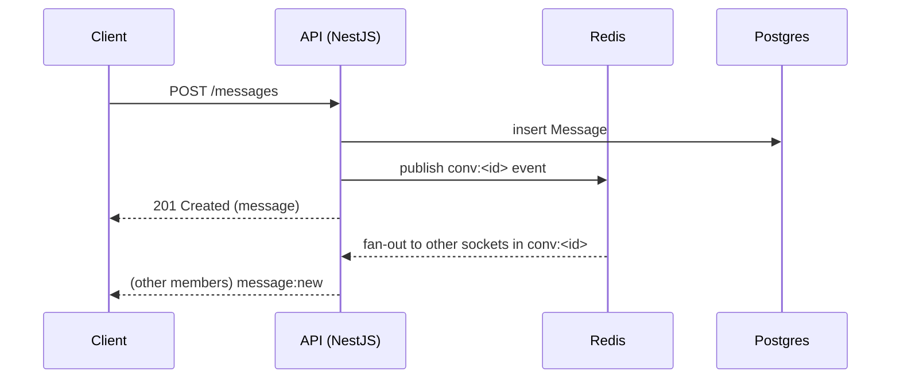

# Telegram-Inspired Chat App — PRD/TDD Specification Suite

> Status: **Living specification**. This suite defines the target product and technical
> behavior for a Telegram-inspired messaging application. It is the reference used by
> design, frontend, backend, and QA when building or reviewing features. Where the
> current codebase (`apps/api` NestJS service, `apps/web` React client) implements a
> subset of what's described here, that is called out explicitly as **MVP status** boxes
> inside each doc. Nothing in this suite claims to reverse-engineer or reimplement
> Telegram's actual MTProto protocol — every backend recommendation targets our own
> stack: **NestJS + Prisma + PostgreSQL + Socket.IO + Redis + BullMQ (+ RabbitMQ for
> domain events at scale)**.

## 1. Purpose of this Document Set

This is a Product Requirements Document (PRD) merged with a Technical Design Document
(TDD), split into feature-oriented files. Each file is written to be independently
readable by:

- **Product/Design** — Purpose, UI Layout, UX Behavior, User Flow, States, Edge Cases,
  Accessibility, Mobile/Desktop differences, Animation details.
- **Backend engineers** — Backend Requirements, API Requirements, Database Requirements,
  Real-time Events, Permissions, Validation.
- **Frontend engineers** — UI Layout, UX Behavior, States, Loading/Empty/Error states,
  Animation Details, Real-time Events (client-side handling).
- **QA** — Edge Cases, States, Validation, Permissions.

Every feature section in every doc follows the **same fixed structure** (skip a
subsection only if genuinely not applicable, and say so explicitly rather than omitting
it silently):

1. **Purpose** — why the feature exists, what user problem it solves.
2. **UI Layout** — structural composition of the screen/component, in reading order.
3. **UX Behavior** — interaction rules, timing, feedback loops.
4. **User Flow** — step-by-step numbered flow(s) from entry to completion.
5. **States** — enumerated UI/data states (default, loading, empty, error, success, etc).
6. **Edge Cases** — boundary conditions, race conditions, unusual input.
7. **Backend Requirements** — services, jobs, business logic that must exist server-side.
8. **API Requirements** — REST endpoints and/or WS events with method, path, payload shape.
9. **Database Requirements** — Prisma-style models/fields/indexes needed.
10. **Real-time Events** — Socket.IO event names, direction, payload, room targeting.
11. **Permissions** — who can perform the action, role/ownership checks.
12. **Validation** — input constraints, server + client validation rules.
13. **Accessibility** — keyboard nav, screen reader labels, focus management, contrast.
14. **Mobile Differences** — Android/iOS-specific layout or behavior deltas.
15. **Desktop Differences** — Desktop/Web-specific layout or behavior deltas.
16. **Animation Details** — durations, easing curves, choreography.
17. **Loading/Empty/Error States** — explicit content and behavior for these three states
    (where applicable to the feature).

## 2. Document Index

### Product & Screens

| # | File | Covers |
|---|------|--------|
| 00 | `00-README.md` | This index, conventions, platform matrix, glossary |
| 01 | `01-authentication.md` | Welcome, phone login, country picker, OTP, QR, 2FA, sessions, multi-device, rate limits |
| 02 | `02-home.md` | App shell, navigation chrome, profile shortcut, connection banner, theming |
| 03 | `03-chat-list.md` | Rows, pinned/archived/folders, unread/mute, drafts, context menus, sorting |
| 04 | `04-conversation.md` | Full conversation: header, bubbles, composer, reactions, selection, shortcuts |
| 05 | `05-groups.md` | Creation, roles, permissions, invites, slow mode, history, topics |
| 06 | `06-channels.md` | Broadcast model, admins, discussion groups, stats, signed posts |
| 07 | `07-settings.md` | Every settings page: privacy, notifications, data, appearance, devices, advanced |
| 08 | `08-search.md` | Global + in-chat search, ranking, filters, keyboard nav |
| 09 | `09-profile.md` | User/group/channel profiles, shared media, block/report/actions |
| 10 | `10-notifications.md` | Desktop/Web/FCM/APNs, mute, badges, push worker |
| 11 | `11-media.md` | Media viewer, albums, compression, editor, shared media |
| 12 | `12-files.md` | Upload/download, drag-drop, paste, voice messages, size limits |
| 13 | `13-calls.md` | Voice/video/group calls, screen share, WebRTC/SFU design |

### Backend & Infrastructure

| # | File | Covers |
|---|------|--------|
| 14 | `14-websocket-events.md` | Complete Socket.IO event catalog + reconnect protocol |
| 15 | `15-rest-api.md` | Complete REST endpoint inventory (OpenAPI-oriented) |
| 16 | `16-database.md` | Tables, indexes, ER diagram; links to Prisma proposal |
| 17 | `17-redis.md` | Key strategy, TTLs, presence, rate limits, pub/sub |
| 18 | `18-rabbitmq.md` | Domain events, BullMQ vs RabbitMQ, retries, DLQ |
| 19 | `19-security.md` | Auth, privacy, upload security, GDPR, abuse |

### Design System, Quality & Planning

| # | File | Covers |
|---|------|--------|
| 20 | `20-ui-components.md` | Component inventory, props, variants, a11y |
| 21 | `21-design-system.md` | Tokens, typography, motion, layout, do/don't |
| 22 | `22-edge-cases.md` | Cross-cutting edge-case catalog |
| 23 | `23-performance.md` | Caching, virtualization, SLOs, optimization |
| 24 | `24-accessibility.md` | WCAG 2.2 AA, keyboard, live regions, RTL |
| 25 | `25-testing.md` | Unit/e2e/load/security/a11y strategy |
| 26 | `26-roadmap.md` | Phased plan from MVP → production feature parity |

### Companion Artifacts

| Path | Covers |
|------|--------|
| [`../inventories/feature-checklist.md`](../inventories/feature-checklist.md) | Complete feature checklist vs Telegram |
| [`../inventories/ui-component-inventory.md`](../inventories/ui-component-inventory.md) | UI component checklist |
| [`../inventories/ux-interaction-inventory.md`](../inventories/ux-interaction-inventory.md) | Gestures, shortcuts, menus |
| [`../inventories/backend-endpoint-inventory.md`](../inventories/backend-endpoint-inventory.md) | REST inventory (summary) |
| [`../inventories/websocket-event-inventory.md`](../inventories/websocket-event-inventory.md) | WS event inventory (summary) |
| [`../schemas/prisma-schema-proposal.prisma`](../schemas/prisma-schema-proposal.prisma) | Full target Prisma schema |
| [`../architecture/folder-structure.md`](../architecture/folder-structure.md) | Proposed monorepo structure |

### Reading order

- **New contributors:** `00` → `21` → `02` → `03` → `04` → `01`
- **Backend vertical slice:** Backend/API/Database/Real-time subsections of the feature
  doc, then `14`–`19`
- **Frontend vertical slice:** UI/UX/States/Animation of the feature doc, then `20`–`21`
- **QA:** `22` + `25` + Edge Cases subsections of the feature under test
- **Planning:** `26` + inventories

## 3. How to Use This PRD

- **Do not treat this as frozen.** When a feature's real-world implementation diverges
  (for good reason — technical constraint, scope cut, user feedback), update the doc in
  the same PR that changes behavior. Docs and code drift apart otherwise.
- **MVP Status boxes.** Every major feature has a small callout:

  > **MVP Status:** ✅ Implemented / 🟡 Partial / ⛔ Not implemented — short note.

  This tells engineers whether they're building greenfield or extending existing code.
- **Cross-references** use the pattern `See 04-conversation.md §Reactions`.
- **IDs are illustrative.** Every JSON payload example uses UUIDv4-shaped placeholder IDs
  (e.g. `"conv_id": "b3f1..."`) — copy the *shape*, not the literal value.
- **REST + WS pairing.** Nearly every mutating REST call has a matching Socket.IO
  broadcast so that other online members/sessions update live. When documented, both are
  listed together under **API Requirements** (REST) and **Real-time Events** (WS
  broadcast), and they should be implemented together, not separately.
- **Numbers are defaults, not law.** Debounce timings, page sizes, and retention windows
  are sensible defaults inspired by Telegram's public behavior; they are configuration
  values (env vars / DB-backed feature flags), not hardcoded constants, unless stated
  otherwise.
- **Current vs target API.** The running codebase today uses `/api` and Socket.IO
  namespace `/chat`. This suite documents the **target** contract as `/api/v1` and `/ws`.
  Migration notes appear in `15-rest-api.md` and `14-websocket-events.md`.

## 4. Platform Matrix

This spec targets four platform surfaces. "Desktop" and "Web" share ~95% of layout and
behavior (both are the same React codebase, `apps/web`, with Desktop meaning an Electron/
Tauri-style wrapper or simply a wide browser viewport ≥ 1080px). "Android" and "iOS" are
native-shaped mobile experiences (could be React Native, or a mobile-web PWA styled to
match native conventions — this spec describes the *behavior contract*, not the render
technology).

| Capability | Desktop (≥1080px / native shell) | Web (browser, any width) | Android | iOS |
|---|---|---|---|---|
| Layout model | Two/three-pane (folders + chat list + conversation + optional info panel) | Responsive: two-pane ≥ 900px, single-pane below | Single-pane, stack navigation | Single-pane, stack navigation |
| Navigation | Persistent sidebar, no back button (panes coexist) | Same as Desktop above breakpoint; browser back button below breakpoint maps to pane pop | Native back gesture/button pops one pane | Swipe-back gesture / nav bar back button |
| Notifications | OS-native toast + tray/badge icon | Web Push (if permitted) + in-tab badge favicon | Native push (FCM), heads-up + status bar icon | Native push (APNs), banner + badge |
| Login method priority | QR code (primary), phone+OTP (fallback) | Phone+OTP (primary), QR (secondary) | Phone+OTP (primary), QR to log in *another* device | Phone+OTP (primary), QR to log in *another* device |
| Keyboard shortcuts | Full set (§04, §Shortcuts) | Full set, minus OS-reserved combos | N/A (on-screen keyboard shortcuts only for hardware keyboards) | N/A (hardware keyboard support via shortcuts, limited) |
| Context menu trigger | Right-click | Right-click / long-press (touch) | Long-press | Long-press / haptic-touch |
| Swipe actions | N/A (mouse-driven) | Touch: swipe on touch-capable browsers | Swipe left/right on chat rows and messages | Swipe left/right on chat rows and messages |
| Voice/video calls | Documented in `13-calls.md` (post-MVP) | Yes (WebRTC) | Yes | Yes |
| Local media cache | Disk cache, configurable size/location | Browser cache storage (quota-limited) | Disk cache w/ auto-download rules per network type | Disk cache w/ auto-download rules per network type |
| Background behavior | App stays running, tray icon | Tab throttled by browser when hidden; relies on Push for wake | OS-managed background service + push wake | OS-managed background refresh + push wake (stricter limits) |
| Max pane width | Chat list pane fixed ~420px, conversation flexible | Same, collapses to 100% below breakpoint | 100% width always | 100% width always |
| Font size/Dynamic Type | User setting in-app | User setting in-app + respects browser zoom | Respects OS font scale | Respects OS Dynamic Type |

## 5. Conventions Used Throughout This Suite

### 5.1 Terminology conventions

- **"User"** = an authenticated account. **"Peer"** = the other party in a 1:1 dialog,
  from the current user's point of view. **"Member"** = a participant in a group/channel.
- **"Chat"** is the umbrella UI term for any row in the chat list — it can back onto a
  Direct dialog, Group, Channel, or the Saved Messages chat with self.
- Numbered **User Flow** steps assume the happy path unless a step is explicitly marked
  **(alt)** for a branch.
- Time values: all timestamps are stored and transmitted as UTC ISO-8601
  (`2026-07-13T10:03:00.000Z`) or Unix millisecond epoch over WS for compactness; clients
  render in local time / relative time ("2m ago", "yesterday").

### 5.2 API convention

- Base REST path: `/api/v1/...`. All authenticated requests carry
  `Authorization: Bearer <accessToken>`.
- Pagination: cursor-based, `?cursor=<opaque>&limit=<n>`, response includes
  `{ items: [...], nextCursor: string | null }`.
- Errors: uniform envelope
  ```json
  { "error": { "code": "AUTH_INVALID_OTP", "message": "The code you entered is incorrect.", "details": {} } }
  ```
- WS namespace: `/ws` (Socket.IO), authenticated via handshake `auth: { token }`. Rooms
  are named `user:<userId>` (personal, for cross-device sync) and `conv:<conversationId>`
  (per-conversation broadcast).

### 5.3 Diagram conventions

Flow and sequence diagrams use Mermaid where helpful. Example:



## 6. Backend Stack Mapping (Reference)

This spec's "Backend Requirements" sections consistently target the following concrete
technology mapping. Read this once; it is not repeated verbatim in every doc.

| Concern | Technology | Notes |
|---|---|---|
| HTTP API | NestJS (Express adapter), modular per-domain (`AuthModule`, `ChatModule`, `UserModule`, ...) | Controllers thin, business logic in Services |
| Realtime transport | Socket.IO server co-hosted in the NestJS process (or a dedicated `ws` microservice behind the same gateway at scale) | Redis adapter (`@socket.io/redis-adapter`) for multi-instance fan-out |
| Persistence | PostgreSQL via Prisma ORM | UUID PKs, snake_case columns via `@map`, timestamptz |
| Cache / ephemeral state | Redis | presence, typing indicators, rate-limit counters, OTP codes, session denylist, pub/sub fan-out across API instances |
| Background jobs | BullMQ (Redis-backed queues) | push notification dispatch, media transcoding/thumbnailing, scheduled message delivery, message deletion sweeps |
| Domain events (scale) | RabbitMQ (optional Phase 10) | Cross-service fan-out when splitting notification/media workers into separate processes |
| File storage | Local disk volume (dev) / S3-compatible object storage (prod) behind a signed-URL upload flow | `UploadModule` issues pre-signed URLs; workers generate thumbnails/waveforms via BullMQ |
| Auth tokens | JWT access token (short-lived, ~15 min) + rotating refresh token (httpOnly cookie or secure storage) | Refresh tokens hashed at rest (`RefreshToken` / `Session` table) |
| Rate limiting | Redis token-bucket / fixed-window counters, enforced in a NestJS Guard/Interceptor (`RateLimitModule`) | Keyed by IP + phone number + user ID depending on endpoint |
| Search | PostgreSQL full-text (`tsvector`) for MVP; pluggable to OpenSearch/Meilisearch at scale | Per-conversation and global search |
| Push notifications | FCM (Android/Web Push) + APNs (iOS), dispatched from a BullMQ worker | Fan-out based on device tokens stored per session |

## 7. Glossary

| Telegram term | Meaning in this spec | Our architecture equivalent |
|---|---|---|
| **Chat** | Any entry in the chat list: a dialog with a person, group, channel, or Saved Messages | `Conversation` row (Prisma model) rendered as a chat-list item |
| **Dialog** | A single 1:1 or group conversation "thread" | `Conversation` (type `DIRECT`, `GROUP`, `CHANNEL`) |
| **Peer** | The other identity you're chatting with | The other `ConversationMember`(s), or `Conversation` itself for groups/channels |
| **Folder (Chat Folder)** | A user-defined or default filtered view over the chat list | `ChatFolder` model with include/exclude rules |
| **Channel** | Broadcast-only conversation type | `Conversation.type = CHANNEL` + role gating `canPost` |
| **Group / Supergroup** | Many-to-many conversation with membership list, admins, permissions | `Conversation.type = GROUP` (+ `isSupergroup` flag) |
| **Saved Messages** | A chat with yourself | `Conversation.type = SAVED` |
| **Contact** | A user you've added to your address book | `Contact` model |
| **Presence** | Online / "last seen" status | Redis key `presence:<userId>` + `presence:update` WS |
| **Draft** | Unsent composer text/attachment kept per-chat | `Draft` model (or Redis + Postgres flush) |
| **Read receipt / "Seen"** | Marker showing a message has been read | `MessageStatus` + per-member `lastReadAt` |
| **Typing indicator** | Ephemeral "X is typing…" signal | Redis + WS `typing:start` / `typing:stop` |
| **Forward** | Re-sending an existing message with attribution | `Message.forwardedFromId` |
| **Reply** | Quoting/linking to a prior message | `Message.replyToId` |
| **Pinned message** | Message pinned for visibility | `Message.isPinned` + `pinnedAt` |
| **Mute** | Suppress notifications for a chat | `ConversationMember.mutedUntil` |
| **Archive** | Move a chat out of the main list | `ConversationMember.isArchived` |
| **Sticker / Sticker pack** | Themed image/animation sent as a message | `StickerPack`, `Sticker`; `Message.type = STICKER` |
| **Poll / Quiz** | Structured multi-choice message | `Poll`, `PollOption`, `PollVote` |
| **Scheduled message** | Message queued for future send | `Message.scheduledFor` + BullMQ delayed job |
| **Cloud Password (2FA)** | Optional secondary password at login | `User.twoFactorHash` |
| **Session** | One logged-in device/client instance | `Session` model |
| **QR Login** | Scan QR on logged-out device from logged-in device | `LoginToken` + WS `qr:<token>` |
| **Slow mode** | Per-member send cooldown in busy groups | `Conversation.slowModeSeconds` |
| **Last seen / privacy** | Granular visibility rules | `PrivacySetting` model |

## 8. Non-Goals of This Spec

To keep scope honest, this suite explicitly does **not** cover:

- Payments / Telegram Stars / Stars subscriptions.
- Full Bot API platform / Mini Apps runtime (document hooks only where relevant).
- Admin/moderation backoffice tooling (reserved for a future `27-admin.md`).
- Any claim of MTProto protocol compatibility or interoperability with real Telegram
  servers/clients. This is an original implementation "inspired by" Telegram's UX,
  built entirely on REST + WebSocket (Socket.IO) + our own database schema.
- Cloning Telegram client source code.

Voice/video calling **is** specified in `13-calls.md` as a target product surface, but is
explicitly post-MVP.

## 9. Current Codebase Snapshot (2026-07-13)

| Area | Status |
|------|--------|
| Auth (email/username + password, JWT) | ✅ |
| Telegram-like shell (sidebar + chat) | ✅ |
| DM / Group / Saved Messages | ✅ (groups: no roles) |
| Realtime typing / presence / seen | ✅ |
| Reply / forward / pin / edit / delete / reactions | ✅ |
| File / image / voice upload | ✅ (15 MB limit) |
| Global + in-chat search | 🟡 |
| Archive | 🟡 (API exists; UI partial) |
| Mute / drafts | 🟡 (client-only) |
| Folders / Channels / Calls / Push / 2FA / QR | ⛔ |
| Phone OTP login | ⛔ (email/password MVP) |

## 10. Change Log

| Date | Change |
|------|--------|
| 2026-07-13 | Initial publication of docs `00`–`04` scaffold. |
| 2026-07-13 | Expanded suite to full `01`–`26` PRD/TDD + inventories + Prisma proposal + folder structure. |
