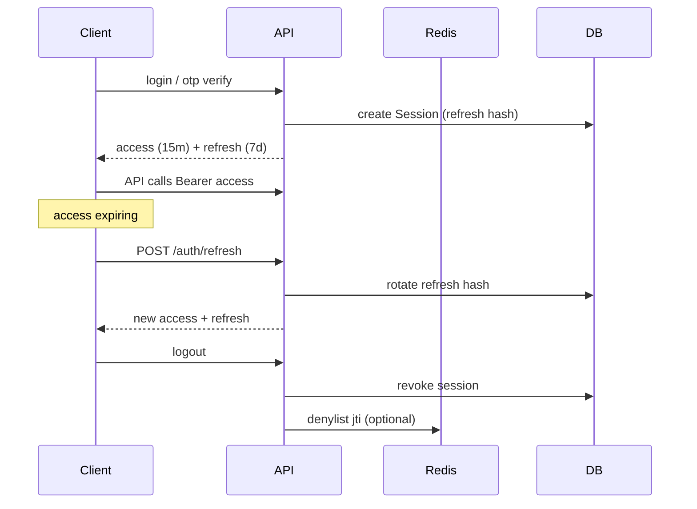

# 01 — Authentication

> **MVP Status:** 🟡 Partial — email/username + password register/login/refresh/logout and `GET /me` are implemented. Phone OTP, country picker, QR login, cloud password (2FA), passkeys, and multi-device session management UI are **not** implemented. This doc specifies the **target** Telegram-inspired auth product; MVP notes call out the current path.

---

## 0. Product Intent

Telegram treats authentication as a **phone-number identity** with optional cloud password, seamless multi-device sync, and desktop-first QR login. Our product mirrors that UX contract while supporting a transitional **email/password** path (current MVP) so the app remains usable before SMS/OTP infrastructure is wired.

**Design rationale (why Telegram does it this way):**
- Phone numbers are universal identifiers and resist username squatting at signup.
- OTP reduces password reuse risk; cloud password protects against SIM-swap.
- QR login removes typing friction on Desktop/Web when a trusted phone is nearby.
- Session list makes account takeovers visible and recoverable.

**Advantages:** Low friction, multi-device by default, high recovery visibility.  
**Disadvantages:** SMS cost/deliverability, SIM-swap risk, regulatory SMS friction.  
**Improvements for us:** Support email+password *and* phone OTP; require 2FA for privileged actions; device naming + geo on sessions; passkeys as progressive enhancement.

---

## 1. Welcome Screen

### Purpose
First-run brand + entry into login or registration. Communicates product identity before asking for credentials.

### UI Layout (reading order)
1. Full-bleed atmospheric background (subtle gradient + soft mesh — not flat white; not purple cliché).
2. Brand wordmark (hero-level), vertically centered-upper third.
3. One headline (secondary to brand): e.g. “Fast. Private. Everywhere.”
4. One supporting sentence.
5. Primary CTA: **Start Messaging** / **Log In**.
6. Secondary text link: **Create Account** (or combined flow).
7. Footer: Terms of Service + Privacy Policy links; language selector (compact).

### UX Behavior
- Auto-detect locale → preselect language.
- If refresh token valid → skip welcome, go to home (silent bootstrap).
- If refresh expired but present → attempt refresh; on failure show welcome with soft “Session expired” toast.
- Desktop/Web: prefer QR entry as secondary CTA after primary phone path once OTP exists.
- Animations: brand fade+rise 320ms; CTA delay 80ms.

### User Flow
1. App launches cold.
2. Bootstrap checks tokens.
3. No session → Welcome.
4. User taps **Start Messaging** → Phone Login (target) or Email Login (MVP).
5. User taps **Create Account** → Registration.

### States
| State | UI |
|-------|-----|
| Default | Brand + CTAs |
| Bootstrapping | Full-screen spinner / skeleton shell |
| Session expired | Welcome + toast |
| Offline | Banner “Waiting for network”; CTAs disabled |

### Edge Cases
- Deep link `app://login?qr=1` opens QR pane directly.
- Already logged in on another tab: BroadcastChannel/`storage` event → redirect home.
- Right-to-left locales: mirror layout.

### Backend / API / DB / Realtime
Not applicable beyond health check `GET /api/v1/health`.

### Permissions / Validation
N/A.

### Accessibility
- Brand is `role="img"` with accessible name.
- CTAs are real `<button>` / links, not divs.
- Focus lands on primary CTA after bootstrap.
- Contrast ≥ 4.5:1 on text over background (scrim if needed).

### Mobile Differences
- Android/iOS: system splash then Welcome; no QR as primary.
- Safe-area insets respected.
- “Continue with system account” not used (we are not OAuth-first).

### Desktop Differences
- Window chrome may show “Log in by QR code” as prominent secondary.
- Keyboard: `Enter` activates primary CTA; `Tab` cycles.

### Animation Details
- Brand: `opacity 0→1`, `translateY 12→0`, 320ms `cubic-bezier(0.2, 0.8, 0.2, 1)`.
- CTA group: stagger 60ms.
- Reduced motion: opacity only.

### Loading / Empty / Error
- Loading = bootstrap only.
- Empty N/A.
- Error: offline banner; fatal config error shows retry.

---

## 2. Phone Login (Target)

### Purpose
Identify the user by E.164 phone number and initiate OTP delivery.

### UI Layout
1. Back button (to Welcome).
2. Title: “Your phone number”.
3. Subtitle: explanation that code will be sent.
4. Country selector row (flag + country name + dial code) → opens Country Picker.
5. Phone input (national number), autofocus.
6. Optional checkbox: “Keep me signed in” (maps to longer refresh / persistent session).
7. Primary: **Next**.
8. Desktop: link “Log in by QR code”.

### UX Behavior
- Country defaults from IP geo or locale (`navigator.language`) with manual override.
- As user types, format national number with lightweight mask (libphonenumber-js).
- `Next` enabled only when number is possible/valid for selected country.
- On submit: disable input, show inline spinner on button, call `POST /auth/otp/request`.
- Flood wait: show countdown; disable resend/next until elapsed.
- Wrong format: inline error under field, no toast spam.

### User Flow
1. Enter/confirm country.
2. Enter phone.
3. Tap Next.
4. Server validates + rate-limits + sends OTP.
5. Navigate to OTP Verification with masked phone display.

### States
`idle` | `validating_local` | `submitting` | `flood_wait` | `error_invalid` | `error_network` | `success_nav`

### Edge Cases
- Leading `0` national trunk prefix stripped per country rules.
- Paste of full `+98912...` parses country + national parts.
- VOIP numbers: optionally reject with `AUTH_PHONE_VOIP_REJECTED`.
- Landline: allow OTP via call fallback only.
- Change country mid-edit: reformat number; may invalidate previous validity.
- User already registered vs new: same OTP screen; registration name step only if `isNewUser`.

### Backend Requirements
- `AuthOtpService.requestOtp(phoneE164, ip, deviceMeta)`
- Normalize to E.164; reject invalid.
- Redis rate limits (see §Rate Limiting).
- Generate 5–6 digit code; store hash in Redis `otp:{phone}` TTL 300s.
- Dispatch SMS via provider (Twilio/MessageBird/etc.) through BullMQ `sms.send` job.
- Do not reveal whether phone is registered (anti-enumeration) — always “code sent” if rate limit allows.
- Log request metadata for abuse review (hashed phone, IP, device).

### API Requirements
```http
POST /api/v1/auth/otp/request
{
  "phone": "+989121234567",
  "channel": "sms" | "call",
  "deviceId": "uuid",
  "platform": "web" | "desktop" | "android" | "ios"
}
```
Responses:
- `200 { "ok": true, "expiresInSec": 300, "resendAfterSec": 60, "isNewUser": false }`
- `429 { "error": { "code": "AUTH_FLOOD_WAIT", "details": { "retryAfterSec": 120 } } }`
- `400 AUTH_PHONE_INVALID`

### Database Requirements
- Optional `OtpAudit` table for long-term abuse analytics (not the code itself).
- Codes live in Redis only.

### Real-time Events
None for SMS path. QR path uses WS (see §QR Login).

### Permissions
Public endpoint. Strict IP + phone rate limits.

### Validation
- Phone must parse as mobile (configurable) via libphonenumber.
- `channel` enum.
- `deviceId` UUID required for session binding later.

### Accessibility
- Country button announces “Country, Iran, plus 98”.
- Phone field `autocomplete="tel"`, `inputmode="tel"`.
- Errors linked via `aria-describedby`.

### Mobile Differences
- Android: Autofill SMS OTP hint API later on OTP screen.
- iOS: `textContentType = telephoneNumber`.
- Country picker is full-screen sheet.

### Desktop Differences
- Compact modal or centered card max-width 420px.
- QR link visible.

### Animation Details
- Field shake 200ms on invalid submit.
- Button loading morph to spinner 150ms.

### Loading / Empty / Error
- Loading: button spinner.
- Error: inline + optional toast for network.
- Flood: countdown text replaces helper.

---

## 3. Country Picker

### Purpose
Select dialing country/region quickly.

### UI Layout
1. Search field (autofocus).
2. Virtualized list: flag, country name, dial code.
3. Optional “Frequently used” section pinned top.
4. Section headers by alphabet (sticky).

### UX Behavior
- Search matches name, ISO code, dial code.
- Keyboard: type-ahead, arrows, Enter select, Esc close.
- Selecting closes picker and returns focus to phone field.

### User Flow
1. Open from phone login.
2. Search or scroll.
3. Select → apply country + dial code.

### States
`loading_list` | `ready` | `no_results`

### Edge Cases
- Territories with shared dial codes (US/CA `+1`): disambiguate by country name; store ISO2.
- Sanctioned/blocked regions: hide or disable with policy flag.
- Offline: ship static country JSON in client bundle.

### Backend / API / DB / Realtime
Static client asset; optional `GET /api/v1/meta/countries` for remote updates.

### Permissions / Validation
N/A / ISO2 must be known code.

### Accessibility
- `role="dialog"` + `aria-modal`.
- Listbox pattern; options `role="option"`.
- Search `role="searchbox"`.

### Mobile / Desktop
- Mobile: full-screen; large touch rows 48px+.
- Desktop: popover 360×480.

### Animation
- Sheet slide up 280ms; desktop fade+scale 160ms.

### Loading / Empty / Error
- Empty search: “No countries found”.
- Loading rare (static).

---

## 4. OTP Verification

### Purpose
Prove phone possession.

### UI Layout
1. Back (returns to phone; may invalidate pending OTP UX-wise but server TTL remains).
2. Title: “Check your messages” / “Enter code”.
3. Subtitle: “We’ve sent a code to +98 ••• ••• 4567”.
4. OTP input: 5–6 separate boxes or single segmented field.
5. Resend link with countdown.
6. “Call me” fallback link after first countdown.
7. Help: “Wrong number?” → back.

### UX Behavior
- Autofocus first digit; auto-advance; paste full code fills all.
- Auto-submit when last digit entered.
- On success: if `isNewUser` → Registration profile step; else issue tokens → Home.
- On wrong code: shake, clear, increment attempts.
- After N failures: lockout / flood wait.
- Resend enabled after `resendAfterSec`; switching to call uses `channel: "call"`.

### User Flow
1. Land from phone login.
2. Enter code (or SMS autofill).
3. Server verifies.
4a. Existing user → sessions + tokens → Home.
4b. New user → Collect name/avatar.
4c. If 2FA enabled → Cloud Password screen before tokens.

### States
`awaiting_input` | `submitting` | `invalid_code` | `expired` | `flood_wait` | `resend_cooldown` | `success`

### Edge Cases
- Code expires mid-entry → “Code expired. Resend.”
- Multiple OTPs: only latest valid (Redis overwrite).
- Clock skew: server TTL authoritative.
- User requests OTP on Device A, enters on Device B: allowed if same phone challenge id or phone key.
- App killed mid-OTP: restore phone from `sessionStorage` challenge blob (not the code).

### Backend Requirements
- `verifyOtp(phone, code, deviceMeta)` compares Argon2/HMAC hash in Redis.
- Increment `otp:attempts:{phone}`; lock at 5 attempts for 15–60 min.
- On success: delete OTP keys; create/find User by phone; if 2FA, return `pendingToken` (not full access).
- Create `Session` + refresh token hash; return access + refresh.

### API Requirements
```http
POST /api/v1/auth/otp/verify
{
  "phone": "+989121234567",
  "code": "12345",
  "deviceId": "uuid",
  "deviceName": "Chrome on Windows",
  "platform": "web"
}
```
Success (no 2FA):
```json
{
  "accessToken": "...",
  "refreshToken": "...",
  "user": { "id": "...", "displayName": "...", "username": null, "avatarUrl": null },
  "isNewUser": false
}
```
Success needing 2FA:
```json
{ "requires2FA": true, "pendingToken": "...", "hint": "My dog's n..." }
```
Errors: `AUTH_INVALID_OTP`, `AUTH_OTP_EXPIRED`, `AUTH_FLOOD_WAIT`.

### Database Requirements
```prisma
model User {
  phoneE164     String?  @unique @map("phone_e164")
  phoneVerifiedAt DateTime? @map("phone_verified_at")
  twoFactorHash String?  @map("two_factor_hash")
  twoFactorHint String?  @map("two_factor_hint")
  // email/password remain for MVP path
}
model Session {
  id           String   @id @default(uuid())
  userId       String
  refreshHash  String   @unique
  deviceId     String
  deviceName   String?
  platform     String
  ip           String?
  userAgent    String?
  lastActiveAt DateTime
  createdAt    DateTime @default(now())
  revokedAt    DateTime?
}
```

### Real-time Events
After full login, client connects WS with access token; server emits `session:created` to `user:{id}` for other devices (optional toast “New login”).

### Permissions
Public + pending rate limits.

### Validation
- Code: `^\d{5,6}$`
- Constant-time compare.

### Accessibility
- OTP group labelled; each box `aria-label="Digit n of 5"`.
- Errors in `aria-live="assertive"`.
- Autocomplete `one-time-code`.

### Mobile Differences
- Android SMS User Consent / Retriever.
- iOS QuickType OTP suggestion.
- Haptic on error.

### Desktop Differences
- Paste-friendly single field acceptable.
- No SMS autofill; emphasize “Open Telegram on your phone” only if we later support in-app code (we won’t have Telegram; use SMS/email).

### Animation Details
- Digit pop 120ms.
- Error shake 200ms.
- Success checkmark flash before navigate 250ms.

### Loading / Empty / Error
- Submitting: disable inputs.
- Expired empty: prompt resend.
- Network error: toast + keep digits.

---

## 5. Too Many Attempts / Flood Wait

### Purpose
Protect OTP and login from brute force while remaining understandable.

### UI Layout
- Inline countdown: “Too many attempts. Try again in 0:47.”
- Optional support link.

### UX Behavior
- Client mirrors `retryAfterSec` from 429; also accept `Retry-After` header.
- Persist flood deadline in memory; survive soft navigations.

### Backend
Redis keys:
- `rl:otp:phone:{phone}` fixed window
- `rl:otp:ip:{ip}`
- `otp:attempts:{phone}`
- `rl:login:ip:{ip}` for password path

Suggested limits:
| Action | Limit | Window |
|--------|-------|--------|
| OTP request per phone | 3 | 10 min |
| OTP request per IP | 10 | 10 min |
| OTP verify attempts | 5 | 15 min |
| Password login per IP | 20 | 10 min |
| Password login per account | 10 | 15 min |

### Edge Cases
- Distributed attack: global phone hash blocklist after repeated floods.
- Honest user traveling: allow support unlock via email recovery (future).

---

## 6. QR Login

### Purpose
Log in Desktop/Web instantly by scanning with an already authenticated mobile session.

### UI Layout (Desktop/Web logged-out)
1. Title: “Log in via QR code”.
2. Large QR (token payload URL or raw token).
3. Steps: “Open app on phone → Settings → Devices → Scan QR”.
4. Link: “Log in by phone number”.
5. Status text under QR: “Waiting for scan…”.

### UX Behavior
1. Client `POST /auth/qr/create` → `{ loginToken, expiresInSec, qrPayload }`.
2. Client connects WS room `qr:{loginToken}` or long-polls `GET /auth/qr/{token}/status`.
3. Mobile scans → confirmation sheet: device name, location approx, **Accept** / **Reject**.
4. On Accept: server binds session to desktop; WS emits `qr:approved` with tokens to desktop; mobile gets success toast.
5. Token single-use; expires ~60s; auto-refresh QR when near expiry (rotate token).

### User Flow
1. Desktop shows QR.
2. Mobile scans.
3. Mobile confirms.
4. Desktop receives tokens → Home.
5. Both devices appear in Active Sessions.

### States
`generating` | `waiting` | `scanned_pending_confirm` | `approved` | `rejected` | `expired` | `error`

### Edge Cases
- QR expires mid-confirm → mobile shows error; desktop refreshes.
- Attacker screenshots QR: require mobile confirm with device metadata; short TTL.
- Mobile offline after scan: desktop waits until expiry.
- User rejects: desktop shows “Login rejected” + regenerate.

### Backend Requirements
- `LoginToken` row or Redis `qr:{token}` with status `pending|scanned|approved|rejected`.
- On approve: create Session for desktop deviceId from token metadata; issue JWT pair.
- Audit event `auth.qr.approved`.

### API Requirements
```http
POST /api/v1/auth/qr/create
→ { "loginToken": "...", "expiresInSec": 60, "qrPayload": "chatapp://qr/..." }

POST /api/v1/auth/qr/{loginToken}/scan   (auth required — mobile)
→ { "ok": true, "desktopDeviceName": "Chrome on Windows" }

POST /api/v1/auth/qr/{loginToken}/approve (auth required)
POST /api/v1/auth/qr/{loginToken}/reject  (auth required)
```

### Real-time Events
| Event | Dir | Payload |
|-------|-----|---------|
| `qr:scanned` | S→C (desktop) | `{ loginToken }` |
| `qr:approved` | S→C (desktop) | `{ accessToken, refreshToken, user }` |
| `qr:rejected` | S→C (desktop) | `{ loginToken }` |
| `qr:expired` | S→C | `{ loginToken }` |

### Permissions
- create: public
- scan/approve/reject: authenticated mobile session

### Validation
- Token entropy ≥ 128 bits.
- Approve only if status `scanned` and scanner user matches.

### Accessibility
- QR image has alt “QR code for logging in; expires in 60 seconds”.
- Also show “Can’t scan? Use phone number login”.
- Status in `aria-live="polite"`.

### Mobile Differences
- Mobile does not show QR for self-login; it is the scanner.
- Camera permission required; fallback manual code entry optional.

### Desktop Differences
- QR is primary login method when product matures.

### Animation Details
- QR fade refresh 200ms.
- Approved: check overlay 300ms then route transition.

### Loading / Empty / Error
- Generating skeleton square.
- Camera denied on mobile: instructions to enable permission.

---

## 7. Cloud Password (2FA)

### Purpose
Second factor after OTP (or after password login) so SIM/email compromise alone is insufficient.

### UI Layout
1. Title: “Two-Step Verification”.
2. Password field (masked) + show toggle.
3. Hint text if configured.
4. “Forgot password?” → recovery email flow.
5. Submit.

### UX Behavior
- Uses `pendingToken` from OTP verify.
- On success → full tokens.
- Lockout after repeated failures.

### Backend
- Verify Argon2id hash `User.twoFactorHash`.
- Recovery: send reset to recovery email; clearing 2FA requires recovery code.

### API
```http
POST /api/v1/auth/2fa/verify
{ "pendingToken": "...", "password": "..." }
```

### Settings integration
See `07-settings.md` — enable/disable 2FA, set hint, recovery email.

### MVP Status
⛔ Not implemented.

---

## 8. Registration (Profile Completion)

### Purpose
Collect display identity for new users after phone verify (or as part of email register MVP).

### UI Layout
1. Avatar picker (optional camera/gallery).
2. First name (required), Last name (optional) — or single Display name field for our MVP.
3. Username optional step (can defer to settings).
4. Terms acceptance checkbox if legally required.
5. **Done** / **Continue**.

### MVP Path (current)
`POST /api/auth/register` with email, username, password, displayName — already exists. Keep until phone auth ships; then dual-path:
- Phone-first → profile completion without password.
- Email path remains for enterprise/dev.

### Validation
- Display name 1–64 chars, trimmed, no leading/trailing spaces spam.
- Avatar ≤ 5 MB, image MIME, re-encoded server-side.
- Username: `^[a-zA-Z][a-zA-Z0-9_]{4,31}$`, unique, reserved word list.

### Edge Cases
- User abandons after OTP: account may exist in `provisioned` state with phone set and empty name — prompt completion on next login.
- Duplicate username race: unique constraint + friendly error.

---

## 9. Email + Password Login (MVP — Implemented)

### Purpose
Current working auth for the resume-grade MVP without SMS costs.

### UI Layout
- Email or username field.
- Password field.
- Log in button.
- Link to Register.
- (Future) Link to phone login.

### API (current → target mapping)
| Current | Target |
|---------|--------|
| `POST /api/auth/login` | `POST /api/v1/auth/login` |
| `POST /api/auth/register` | `POST /api/v1/auth/register` |
| `POST /api/auth/refresh` | `POST /api/v1/auth/refresh` |
| `POST /api/auth/logout` | `POST /api/v1/auth/logout` |
| `GET /api/auth/me` | `GET /api/v1/auth/me` |

### Security
- Argon2 password hash.
- Refresh token hashed at rest.
- Rate limit 10/min/IP (current).

> **MVP Status:** ✅ Implemented.

---

## 10. Multi-Device Sessions / Active Sessions

### Purpose
List and revoke devices; surface suspicious logins.

### UI Layout (Settings → Devices)
1. This device (highlighted).
2. Other sessions: device name, platform icon, IP/geo approx, last active relative time.
3. Per-row: Terminate.
4. Bottom: **Terminate all other sessions**.

### UX Behavior
- Opening page fetches `GET /sessions`.
- Terminate calls `DELETE /sessions/:id` then if current → logout local.
- Terminate all others: confirm dialog.
- New login: push + in-app toast on existing devices.

### User Flow
1. Settings → Devices.
2. Review list.
3. Revoke unknown → confirm.
4. Other device loses WS + refresh on next use.

### Backend
- Session model as above; update `lastActiveAt` on REST/WS activity (throttled write every 60s).
- Revoke sets `revokedAt`; refresh fails; access JWT remains until expiry (≤15m) — optional denylist in Redis `session:deny:{jti}`.

### Real-time
`session:revoked` → `user:{id}` with `{ sessionId }` so clients force logout if matched.

### Edge Cases
- Revoke while offline: enforced on next refresh.
- Duplicate deviceId: upsert session row (same physical device reinstall).

> **MVP Status:** 🟡 RefreshToken exists without rich device metadata UI.

---

## 11. Logout

### Purpose
End current session securely.

### Flows
- **Logout this device:** revoke refresh; clear client storage; disconnect WS; navigate Welcome.
- **Logout all:** revoke all sessions; denylist; disconnect all WS via `user:{id}` event.

### API
```http
POST /api/v1/auth/logout
{ "allDevices": false }
```

---

## 12. Account Recovery / Change Phone

### Purpose
Recover access; migrate phone number.

### Change phone
1. Settings → Privacy → Change number.
2. Verify old phone OTP (or 2FA).
3. Verify new phone OTP.
4. Atomically update `phoneE164`.

### Stolen phone
- Terminate sessions from another logged-in device.
- Change phone.
- Enable 2FA.

### Delete account
- Confirm with password/2FA; schedule deletion (e.g. 7 days) like Telegram self-destruct; cancel on login.

> **MVP Status:** ⛔

---

## 13. Passkeys (Optional Enhancement)

### Purpose
WebAuthn/passkey as alternative second factor or passwordless for Web/Desktop.

### Notes
- Document as Phase 9+ enhancement.
- Store `PublicKeyCredential` credentials per user.
- Does not replace phone identity in Telegram model; for us can harden email path.

---

## 14. Cross-Cutting: Token Lifecycle



### Client storage
- Web: memory access token + httpOnly secure cookie refresh (preferred) OR both in memory with refresh in encrypted secret store for desktop.
- Do not put refresh in `localStorage` long-term if XSS risk high; current MVP may use localStorage — migrate.

---

## 15. Presence of Auth Screens — Platform Matrix

| Screen | Desktop | Web | Android | iOS |
|--------|---------|-----|---------|-----|
| Welcome | ✅ | ✅ | ✅ | ✅ |
| Phone + Country | ✅ | ✅ | ✅ primary | ✅ primary |
| OTP | ✅ | ✅ | ✅ + autofill | ✅ + autofill |
| QR show | ✅ primary | ✅ secondary | ❌ | ❌ |
| QR scan | ❌ | ❌ | ✅ | ✅ |
| 2FA | ✅ | ✅ | ✅ | ✅ |
| Email/password MVP | ✅ | ✅ | ✅ | ✅ |
| Sessions | ✅ | ✅ | ✅ | ✅ |

---

## 16. Validation Summary

| Field | Rule |
|-------|------|
| phone | E.164, libphonenumber possible/valid |
| otp | 5–6 digits |
| email | RFC-like, max 254 |
| password | min 8, max 128, complexity policy configurable |
| displayName | 1–64 |
| username | 5–32, pattern above |
| deviceId | UUID |

---

## 17. Accessibility Notes (Auth-wide)

- Logical focus order top→bottom.
- Never rely on color alone for errors (icon + text).
- All images decorative or labelled.
- Support password managers (`autocomplete` tokens).
- 44×44px min touch targets on mobile.

---

## 18. Animation Inventory (Auth)

| Interaction | Duration | Easing |
|-------------|----------|--------|
| Screen push (mobile) | 280ms | standard |
| Modal present (desktop) | 160ms | decelerate |
| Field error shake | 200ms | linear keyframes |
| Button loading | 150ms | ease |
| QR refresh | 200ms | ease |
| Success check | 250ms | spring-ish |

---

## 19. Error Code Catalog (Auth)

| Code | HTTP | Message (en) |
|------|------|--------------|
| AUTH_PHONE_INVALID | 400 | Invalid phone number |
| AUTH_OTP_INVALID | 401 | Invalid code |
| AUTH_OTP_EXPIRED | 401 | Code expired |
| AUTH_FLOOD_WAIT | 429 | Too many attempts |
| AUTH_2FA_REQUIRED | 401 | Two-step verification required |
| AUTH_2FA_INVALID | 401 | Incorrect password |
| AUTH_QR_EXPIRED | 410 | QR code expired |
| AUTH_QR_REJECTED | 403 | Login rejected |
| AUTH_SESSION_REVOKED | 401 | Session ended |
| AUTH_INVALID_CREDENTIALS | 401 | Invalid email/username or password |
| AUTH_EMAIL_TAKEN | 409 | Email already registered |
| AUTH_USERNAME_TAKEN | 409 | Username taken |

---

## 20. Testing Checklist (Auth)

- [ ] OTP happy path new + existing user
- [ ] OTP wrong / expire / flood
- [ ] QR approve / reject / expire
- [ ] 2FA gate
- [ ] Refresh rotation + reuse detection
- [ ] Logout all devices disconnects WS
- [ ] MVP email login regression
- [ ] a11y keyboard-only login
- [ ] RTL welcome + phone

---

## 21. Implementation Mapping to Codebase

| Spec piece | Code today | Action |
|------------|------------|--------|
| Register/login/refresh/logout/me | `apps/api/src/auth` | Keep; version to `/api/v1` |
| RefreshToken | Prisma model | Evolve → Session |
| OTP/QR/2FA | — | New services + Redis |
| Rate limit | `rate-limit` module | Extend keys |
| Web login UI | `apps/web` auth pages | Add phone/QR routes later |

---

*End of 01-authentication.md*
