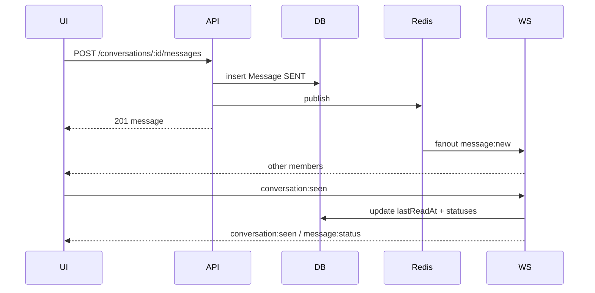

# 04 — Conversation Screen

> **MVP Status:** ✅ Core conversation UI implemented — text bubbles, reply, forward, pin, edit, soft-delete, reactions, typing, seen, voice, images/files, drafts (client), in-chat search, chat info sheet, date separators, optimistic send. 🟡 Selection mode, stickers/GIF panel, scheduled/silent send, server drafts, polls, locations, link-preview SSR, virtualization polish. ⛔ Secret chat, topics, live location, translate, full media editor.

This is the densest surface in the product. Every subsection below is implementable as a vertical slice.

---

## 0. Screen Purpose

The conversation screen is where messaging **happens**: reading history, composing, reacting, and managing thread state (pins, search, info). Telegram optimizes for speed (Enter to send, minimal chrome, optimistic UI) and clarity (bubbles, ticks, separators).

**Why:** Chat is a continuous timeline; users think in messages not documents.  
**Pros:** Familiar, fast, expressive.  
**Cons:** Feature creep in composer/menus; accessibility hard.  
**Improvements:** Clearer multi-select; better keyboard help; spoiler/a11y for media.

---

# A. Header

## Purpose
Identify the peer/chat; surface status; entry to search/call/info.

## UI Layout (LTR)
`[ Back(mobile) ] [ Avatar ] [ Title + Subtitle ] …… [ Search ] [ Call ] [ More ]`

- **Title:** peer name / group title / “Saved Messages”.
- **Subtitle:** online / last seen / `n members` / `n subscribers` / typing / recording / uploading.
- Tap header (center) → profile / info panel.

## UX Behavior
- Subtitle switches to typing with accent color; returns after typing TTL (~5s).
- Connection issues do not replace subtitle (shell banner handles that).
- Call buttons hidden if privacy disallows or feature flag off.

## States
`idle` | `typing` | `recording_voice` | `online` | `last_seen` | `member_count` | `reconnecting_subtitle_optional`

## Edge Cases
- Deleted user title; blocked user still shows history.
- Channel: no online; show subscribers count.
- Long titles truncate with ellipsis; tooltip full name on desktop.

## Backend / API
Depends on conversation detail DTO + presence + typing WS.

## Accessibility
- Header button `aria-label="Chat info for {title}"`.
- Live region for typing optional (polite, throttled).

## Mobile / Desktop
- Mobile: back pops stack; call icons in header or menu.
- Desktop: no back; pin info panel open.

## Animation
- Subtitle cross-fade 150ms.
- Typing text pulse opacity subtle.

## Loading
- Title skeleton until conversation meta loaded.

---

# B. Pinned Messages Bar

## Purpose
Surface important messages without scrolling.

## UI Layout
Slim bar under header: pin icon + truncated text + close (unpin if permitted) + cycle control if multiple.

## UX Behavior
- Tap → scroll to message + highlight flash.
- Multiple pins: tap cycles; Telegram shows stacked — we support ordered list.
- If message deleted, remove from pin bar.

## API
```http
GET /api/v1/conversations/:id/pinned
POST /api/v1/messages/:id/pin { "pinned": true }
```

## Realtime
`message:updated` with `isPinned`.

## Permissions
- DIRECT: either party (our rule) or sender-only — **default: any member**.
- GROUP/CHANNEL: admin `canPin` or owner.

## Animation
- Bar slide down 180ms; highlight yellow flash 800ms on jump.

> **MVP Status:** ✅ Pin API + UI partial.

---

# C. Message List

## Purpose
Virtualized chronological timeline (oldest top → newest bottom). Telegram keeps scroll anchored at bottom when following live.

## UI Layout
- Full-height scroll viewport between header/pin and composer.
- Absolute **Jump to bottom** FAB when not at bottom; shows unread count badge.
- **Unread separator:** horizontal “Unread messages” after last-read boundary.
- **Date separators:** sticky day chips (“Today”, “Yesterday”, “12 July”).

## UX Behavior — Scroll
1. Initial open: jump to last read OR bottom; if unread, position so unread separator is visible.
2. Load older: scroll near top → fetch `cursor` older page; preserve scroll anchor.
3. New message while at bottom: auto-stick; animate in.
4. New message while scrolled up: don’t jump; increment FAB badge; optional subtle peek.
5. Send own message: force scroll bottom.
6. Jump FAB: smooth scroll bottom + mark read.

## Virtualization
- Windowed renderer; estimated heights with measure cache.
- Media messages need async measure — placeholder aspect ratio from metadata.

## States
`loading_initial` | `loading_older` | `at_live_edge` | `scrolled_up` | `empty` | `error`

## Edge Cases
- Message deleted in view → collapse height animated.
- Edit in view → reflow.
- Jump to message from search/pin not mounted → load around id (`GET messages?aroundId=`).
- Huge history: never load all; cursor only.
- RTL messages inside LTR chat: per-bubble `dir=auto`.

## API
```http
GET /api/v1/conversations/:id/messages?cursor=&limit=50&aroundId=
```

## Performance
- Prefetch next page.
- Deduplicate by message id.
- Batch seen receipts.

## Accessibility
- List `aria-label="Messages"`.
- New messages: polite live region when at bottom (careful not to spam).
- Focus management: don’t steal focus from composer on new messages.

## Animation
- Enter: 160ms fade+rise.
- Delete: 150ms collapse.
- Group consecutive same-sender (avatar only on last of group) — Telegram style clustering.

> **MVP Status:** ✅ List exists; virtualization may be incomplete.

---

# D. Message Bubble — Common

## Anatomy
```
[Forward origin?]
[Reply quote bar]
[Content]
[Link preview?]
[Reactions chips]
[Time · edited · ticks]
```

Outgoing aligned end (accent fill); incoming start (surface fill).

## Delivery / Seen Ticks (outgoing only)
| Status | Icon |
|--------|------|
| Sending (optimistic) | clock / spinner |
| SENT | single check |
| DELIVERED | double check |
| SEEN | double check accent color |

Groups: seen often means “seen by at least one” or detailed read list — **MVP: aggregate tick when all catch up optional; default DELIVERED when server ack, SEEN when any peer read in DIRECT; in GROUP use double gray until policy defined — recommend DIRECT-only precise SEEN.**

## Edited Badge
- Small “edited” before time if `editedAt`.
- Edit window: **48h** default (configurable); server rejects after.

## Context Menu Actions (complete)

| Action | Notes |
|--------|-------|
| Reply | Sets composer reply mode |
| Copy | Text or caption |
| Copy message link | If public username chat |
| Forward | Opens chat picker |
| Pin / Unpin | Permissioned |
| Edit | Own text within window |
| Delete | Submenu: for me / for everyone (time-limited) |
| Select | Enter multi-select |
| React | Emoji tray |
| Save to Saved Messages | Forward to SAVED |
| Schedule | Opens datetime picker (composer send-later) |
| Translate | Optional / deferred |
| Show in chat | From search results |
| Report | Policy |

## Selection Mode
- Checkbox per message; toolbar: Forward, Delete, Clear selection, Count.
- Esc exits.

## Reactions
- Long-press / hover smile; recent + full picker.
- One reaction per user per message (MVP matches schema unique); toggle off.
- Chips show emoji + count; highlight if mine.
- WS `message:updated` or `reaction:updated`.

> **MVP Status:** ✅ Reactions single emoji per user.

---

# E. Bubble Types

### TEXT
- Markdown-lite: `*bold*`, `_italic_`, `~strike~`, `` `code` ``, ```blocks```, spoiler `||text||` (target), links autolinked.
- Max length **4096** chars (Telegram-like); show “Show more” if extremely tall.

### IMAGE / ALBUM
- Rounded thumb; caption below/inside.
- Album: grid 2–10; tap opens viewer at index.
- Spoiler media: blurred until tap.

### VIDEO / GIF
- Duration badge; mute GIF autoplay in-thread if setting allows.
- Progressive poster frame.

### STICKER
- No bubble chrome or minimal; size ~160px; animated WebM/Lottie/WebP.

### FILE
- Icon by MIME; filename; size; download progress.

### VOICE
- Waveform; play/pause; speed 1× / 1.5× / 2×; duration; listened indicator optional.

### LOCATION / LIVE LOCATION
- Map preview static image; live updates until expiry.

### CONTACT
- Avatar + name + add button.

### POLL / QUIZ
- Options; live tallies; quiz correct highlight.

### SERVICE / SYSTEM
- Centered plain text: “Alice pinned a message”, “You joined”, date changes already separators.

### CALL EVENTS
- “Incoming call · 3:04” with callback button.

> **MVP Status:** TEXT/IMAGE/FILE/VOICE ✅; others ⛔/🟡

---

# F. Link Preview

## Purpose
Unfurl URLs for richer context.

## Behavior
- Server or client fetch Open Graph; store on message as `linkPreview` JSON.
- Show title, desc, image, site name; tap opens external.
- Privacy: don’t unfurl in secret chats; respect user “generate previews” setting.

## Edge Cases
- Multiple URLs: first only (or Telegram shows one).
- Fail soft — text still sends.

---

# G. Composer

## UI Layout
`[ Attach ] [ Text input multiline ] [ Emoji ] [ Voice / Send ]`

Modes morph:
- **Reply:** bar above input with quote + close.
- **Edit:** bar “Edit message” + close; Send becomes Save.
- **Voice recording:** waveform + timer + lock + cancel slide.
- **Slow mode:** countdown overlay disabling send.
- **Blocked / left / read-only channel:** composer replaced with action (“Join”, “Unblock”, “You can’t post”).

## UX Behavior
- Enter sends (desktop setting); Shift+Enter newline. Mobile: send button always.
- Typing emit start on first char (debounced 300ms); stop on idle 3s or blur/send.
- Attach menu: Photo/Video, File, Poll, Location, Contact, (Camera).
- Emoji panel tabs: Emoji | Stickers | GIFs.
- Drag-drop files onto conversation → upload preview.
- Paste image → image send confirm.
- Silent send: hold send / Ctrl+Enter variant — notification suppressed (`silent: true`).
- Schedule: send menu → “Schedule message”.

## Voice Recording
1. Hold mic → record.
2. Slide left cancel; slide up lock.
3. Locked: pause/resume, send, cancel, trash.
4. Max duration e.g. 1 hour; warning at limit.
5. Upload as `VOICE` with waveform peaks array + durationMs.

## Drafts
- Persist locally immediately; debounce server sync 500–1000ms `PUT /drafts/:conversationId`.
- Clear on send; restore on reopen.
- Cross-device via WS `draft:updated`.

> **MVP Status:** Composer ✅; voice ✅; drafts client-only 🟡; stickers/GIF/schedule/silent ⛔

## Validation
- Empty text + no media → cannot send.
- Trim; allow whitespace-only? **No**.
- File size limits see `12-files.md`.

## Accessibility
- Textarea labelled “Message”.
- Attach/emoji/send named.
- Recording state announced.

## Animation
- Send button ↔ mic morph 150ms.
- Reply bar slide 160ms.
- Recording lock spring.

---

# H. Search in Chat

## UI
Header search expands: query field, match counter `3 of 12`, up/down, clear.

## Behavior
- Debounce 200ms; highlight matches in bubbles; jump between.
- Server: `GET /conversations/:id/messages/search?q=`.
- Client fallback for loaded window only if offline.

> **MVP Status:** 🟡 Client-side in loaded messages / API global exists.

---

# I. Chat Info / Shared Media

## Tabs
Members (groups) | Media | Files | Links | Voice | GIFs | (Groups) Permissions

See `09-profile.md` for peer profile; info panel mirrors subset.

---

# J. Keyboard Shortcuts (Desktop/Web)

| Shortcut | Action |
|----------|--------|
| `Enter` | Send (if setting) |
| `Shift+Enter` | Newline |
| `Ctrl+Enter` | Send silent (target) / alternate send |
| `Esc` | Cancel reply/edit/selection/search |
| `Ctrl+F` | Search in chat |
| `Ctrl+E` | Edit last outgoing |
| `↑` (empty composer) | Edit last outgoing |
| `Ctrl+Shift+M` | Mute chat |
| `Ctrl+P` | Pin selected / focus pins |
| `Delete` / `Backspace` | Delete in selection |
| `Ctrl+A` | Select all visible (careful) |
| Space | Play/pause focused voice/media |

---

# K. Backend — Message Pipeline



### Optimistic UI
- Client temp id `clientMessageId`; server returns canonical id; map replace.
- Failure: mark failed with Retry.

### Idempotency
- Header `Idempotency-Key` or body `clientMessageId` unique per sender.

---

# L. Real-time Events (Conversation)

| Event | Dir | Payload highlights |
|-------|-----|--------------------|
| `conversation:join` | C→S | `{ conversationId }` |
| `message:send` | C→S | optional; REST preferred |
| `message:new` | S→C | full message DTO |
| `message:updated` | S→C | patch fields |
| `message:deleted` | S→C | `{ id, mode }` |
| `message:status` | S→C | `{ id, status }` |
| `typing:start/stop` | C→S | |
| `typing:update` | S→C | `{ userId, kind }` |
| `conversation:seen` | C→S / S→C | `{ conversationId, lastReadAt, userId }` |
| `reaction:updated` | S→C | `{ messageId, reactions }` |
| `presence:update` | S→C | peer online |

---

# M. Database (Message extensions)

```prisma
enum MessageType {
  TEXT IMAGE VIDEO GIF FILE VOICE STICKER AUDIO
  LOCATION LIVE_LOCATION CONTACT POLL SYSTEM CALL
}

model Message {
  // existing...
  clientMessageId String? @map("client_message_id")
  silent          Boolean @default(false)
  scheduledFor    DateTime? @map("scheduled_for")
  linkPreview     Json?     @map("link_preview")
  waveform        Int[]     // or Json
  width           Int?
  height          Int?
  thumbnailUrl    String?
  spoiler         Boolean @default(false)
  @@unique([senderId, clientMessageId])
}
```

---

# N. Permissions Matrix (send)

| Context | Can send |
|---------|----------|
| DIRECT | both unless blocked |
| SAVED | self |
| GROUP | members with `canSend*` flags |
| CHANNEL | admins with `canPost` |
| Slow mode | members limited by interval |
| Banned | no |

---

# O. Platform Differences

| Topic | Desktop/Web | Android | iOS |
|-------|-------------|---------|-----|
| Context menu | Right-click | Long-press | Long-press/haptic |
| Reply gesture | Optional swipe | Swipe reply | Swipe reply |
| Composer | Enter to send | Send button | Send button |
| Emoji panel | Popover | Bottom sheet | Bottom sheet |
| Calls entry | Header | Header | Header |
| Multi-select | Ctrl/Shift | Long-press mode | Long-press mode |

---

# P. Animation Inventory

| Event | Duration |
|-------|----------|
| Bubble in | 160ms |
| Send fly (optional) | 200ms |
| Reaction pop | 180ms spring |
| Highlight jump | 800ms fade |
| FAB show | 150ms |
| Delete collapse | 150ms |

Reduced motion: opacity only.

---

# Q. Loading / Empty / Error

- **Loading:** centered spinner or skeleton bubbles.
- **Empty:** “No messages here yet…” + subtle CTA.
- **Error load:** retry banner atop list.
- **Send error:** failed tick + “Not sent. Tap to retry.”

---

# R. Edge Cases (Conversation-wide)

1. Blocked mid-chat → composer lock; history remains.
2. Removed from group while viewing → read-only banner.
3. Message delete for everyone after you replied → reply quote shows “Original deleted”.
4. Dual edit race → last-write-wins with `updatedAt`; WS patch.
5. Reconnect: resume gap fill via `GET messages?after=lastId`.
6. Clock skew on “edited” windows — server time only.
7. Paste huge text → warn/split? reject over max.
8. Offline queue: ordered flush on reconnect.
9. Peer privacy hides last seen → subtitle “last seen recently” buckets.
10. Forward loops depth — keep attribution to original.

---

# S. Testing Checklist

- [ ] Optimistic send + reconcile
- [ ] Seen in DIRECT multi-device
- [ ] Reply/edit/delete/pin/react
- [ ] Scroll anchor older page
- [ ] Jump to pinned/search
- [ ] Voice lock/cancel
- [ ] Slow mode
- [ ] Read-only channel
- [ ] Keyboard shortcuts
- [ ] a11y composer + list

---

*End of 04-conversation.md*
