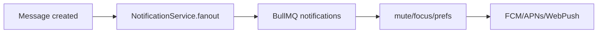

# 10 — Notifications

> **MVP Status:** ⛔ Push not implemented. In-app toasts may exist. Mute is client-only. This doc specifies production notification design.

---

## 1. Purpose

Notifications re-engage users when the app is backgrounded and provide ambient awareness when foregrounded—without becoming noisy (mute, previews, multi-device suppression).

---

## 2. Channels by Platform

| Platform | Technology |
|----------|------------|
| Android | FCM |
| iOS | APNs |
| Web | Web Push (VAPID) |
| Desktop native | OS notifications + tray badge |
| In-app | Toast / in-chat banners |

---

## 3. When to Notify

Notify if ALL true:
1. Message (or eligible event) created.
2. Recipient is member and not sender.
3. Chat not muted (`mutedUntil` null or past) OR event is mention/reply-to-you (configurable bypass).
4. No active session currently focused on that conversation (optional suppression).
5. User global notifications enabled.
6. Privacy/preview settings applied to payload body.

### Events that notify
- New message (DIRECT/GROUP/CHANNEL post)
- Mentions / replies to you
- Group add / join approved
- Incoming call (high priority)
- Session login (security)

### Events that usually don’t
- Typing, presence, reaction (optional setting), silent messages, own messages

---

## 4. Mute Presets

1 hour, 4 hours, 8 hours, 1 day, 7 days, forever (`mutedUntil = far future`).  
UI from chat menu + settings exceptions.

```http
PATCH /api/v1/conversations/:id { "mutedUntil": "2026-07-14T00:00:00Z" }
```

---

## 5. Payload Shape

```json
{
  "title": "Alice",
  "body": "Hello there",
  "data": {
    "conversationId": "...",
    "messageId": "...",
    "type": "message"
  },
  "tag": "conv:...",
  "renotify": true
}
```

Preview off → body = “New message”.

---

## 6. Backend Pipeline



### DB
```prisma
model DevicePushToken {
  id String @id
  userId String
  sessionId String?
  platform String
  token String @unique
  createdAt DateTime
  lastSeenAt DateTime
}
```

### Redis
- `notif:dedupe:{messageId}:{userId}` TTL 10m
- Optional online focus: `focus:{userId}:{sessionId} = conversationId`

---

## 7. Multi-Device Sync

- Read on one device → send silent push / WS to dismiss notifications with same `tag` on others.
- Badge recount from server unread sum periodically.

---

## 8. Badges

- App icon badge = sum of unmuted unreads (policy).
- Favicon badge on web.
- Chat list pills remain source of truth in-app.

---

## 9. Desktop / Web Behavior

- Permission prompt soft (see Home).
- Click focuses window + navigates deep link `/chat/:id`.
- Sound per settings; DND via OS.

---

## 10. Mobile Differences

- Android notification channels: Messages, Groups, Channels, Calls.
- iOS categories with quick reply (future).
- Heads-up for calls.

---

## 11. Edge Cases

- Token invalid → delete token.
- Burst messages → collapse by `tag` conversation.
- Encrypted/secret → generic body always.
- User blocks sender → no notify.
- Timezone mute schedules (quiet hours) optional Phase 6+.

---

## 12. API

```http
POST /api/v1/devices/push-token { "token": "...", "platform": "web" }
DELETE /api/v1/devices/push-token { "token": "..." }
PATCH /api/v1/users/me/notification-settings
GET /api/v1/users/me/notification-settings
```

---

## 13. Accessibility / Animation / States

- Toasts focusable dismiss; don’t steal focus mid-type.
- Banner slide 200ms.
- Loading N/A; empty muted exceptions list; error “Notifications blocked by browser”.

---

## 14. Security

- Push payloads minimal PII; prefer IDs + fetch on open.
- Authenticate token registration to user session.

---

## 15. Testing

- [ ] Mute suppresses
- [ ] Mention bypasses mute if enabled
- [ ] Focused chat suppresses
- [ ] Invalid token removed
- [ ] Click navigates

---

*End of 10-notifications.md*
