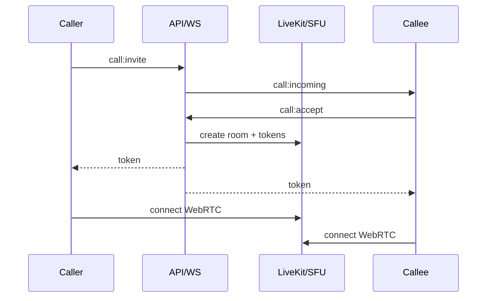

# 13 — Calls (Voice, Video, Group)

> **MVP Status:** ⛔ Not implemented. Full target design below. Prefer **LiveKit** or **mediasoup** SFU over mesh beyond 2–3 peers.

---

## 1. Purpose

Realtime AV communication integrated with chat identity and presence—E2E optional later; MVP calls can be SRTP to SFU with TLS signaling.

---

## 2. Call Types

| Type | Topology | Max (target) |
|------|----------|--------------|
| 1:1 Voice | P2P if allowed else relay | 2 |
| 1:1 Video | same | 2 |
| Group voice chat | SFU | 200 listen / ~30 speak (policy) |
| Screen share | SFU track | 1–N |

---

## 3. Signaling via Socket.IO

Events (namespace `/ws` or `/calls`):

| Event | Dir | Purpose |
|-------|-----|---------|
| `call:invite` | C→S | `{ calleeId, media: "audio"|"video" }` |
| `call:incoming` | S→C | ring callee |
| `call:accept` | C→S | |
| `call:reject` | C→S | |
| `call:end` | C→S / S→C | |
| `call:signal` | both | WebRTC SDP/ICE payloads relayed |
| `call:state` | S→C | room state for group |

REST optional for history:
```http
GET /api/v1/calls/history
POST /api/v1/calls/rooms  // group voice chat
```

---

## 4. Connection States

`idle → ringing → connecting → connected → reconnecting → ended | failed`

UI maps each to copy + animation (pulse ring, spinner, green connected).

---

## 5. Call UI — 1:1

- Fullscreen remote video / avatar for voice.
- Local PiP video.
- Controls bar: Mute, Camera, Switch camera, Screen share, End, Speaker/output.
- Timer since connect.
- Poor connection banner.

### Incoming
- Overlay system notification + in-app modal Accept/Decline; ringtone; vibration mobile.

---

## 6. Group Voice Chat UI

- Participant grid/list with speaking highlight.
- Raise hand; admin mute all; screen share tile.
- Chat can stay open (panel) — Telegram voice chats are in-chat.

---

## 7. Permissions

- Mic/camera browser permissions with preflight screen.
- Privacy: who can call you (Everyone/Contacts/Nobody).
- Group: `canManageVideoChats` admin right.

---

## 8. Backend / WebRTC Architecture



- STUN/TURN (coturn) for NAT.
- Issue short-lived room tokens.
- Persist `CallSession` row for history/billing metrics.

### DB
```prisma
model CallSession {
  id String @id
  type String
  conversationId String?
  initiatorId String
  startedAt DateTime?
  endedAt DateTime?
  status String
}
model CallParticipant {
  callId String
  userId String
  joinedAt DateTime
  leftAt DateTime?
  @@id([callId, userId])
}
```

---

## 9. Edge Cases

- Callee offline → ringing timeout 30–60s → miss call service message.
- Glare (both dial): deterministic winner by userId sort.
- Mid-call network switch → ICE restart.
- Permission revoked mid-call → mute track + banner.
- Background iOS limits — rely on CallKit later for native.

---

## 10. Security

- Authz on room tokens.
- Rate limit invites (anti-harassment).
- Optional E2E insertable streams — future.

---

## 11. Accessibility / Platforms / Animation

- Controls labelled; DTMF N/A.
- Android Telecom / iOS CallKit integration Phase native.
- Desktop: global shortcut accept/decline.
- Ring pulse 1.2s loop; connect cross-fade 200ms.

### Loading / Empty / Error
- Connecting spinner; empty history; failed “Check microphone permissions”.

---

## 12. Testing

- [ ] Invite/accept/reject/end
- [ ] Mute camera toggle
- [ ] TURN relay forced test
- [ ] Missed call message
- [ ] Privacy blocks call

---

*End of 13-calls.md*
