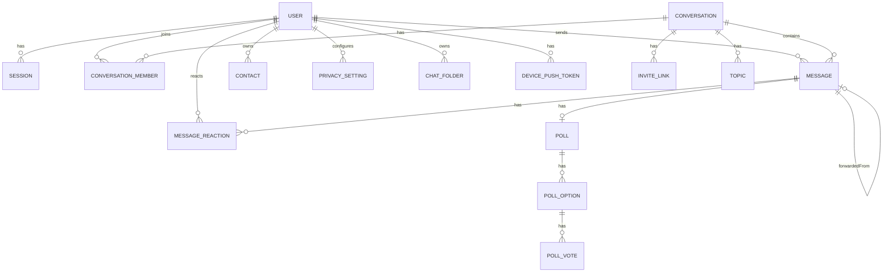

# 16 — Database Design

> **MVP Status:** 🟡 Core `User`, `RefreshToken`, `Conversation`, `ConversationMember`, `Message`, `MessageReaction` exist. This doc is the full target relational design.

---

## 1. Principles

- UUID PKs (`uuid`)
- `timestamptz` via Prisma `DateTime`
- Soft delete for messages (`deletedAt`) and optional users
- Member-scoped settings (mute/pin/archive) on `ConversationMember`
- Denormalize carefully (`lastMessageAt`, `subscriberCount`)
- Index for chat list + message history hot paths

---

## 2. ER Diagram (Mermaid)



---

## 3. Core Tables

### users
| Column | Type | Notes |
|--------|------|-------|
| id | uuid PK | |
| email | citext unique nullable | MVP |
| phone_e164 | text unique nullable | target |
| username | citext unique nullable | |
| password | text nullable | email path / 2FA separate |
| two_factor_hash | text nullable | |
| display_name | text | |
| bio | text nullable | |
| avatar_url | text nullable | |
| birthday | date nullable | |
| created_at / updated_at | timestamptz | |
| deleted_at | timestamptz nullable | |

Indexes: username, phone, email.

### sessions (evolves refresh_tokens)
| Column | Type |
|--------|------|
| id | uuid |
| user_id | uuid FK |
| refresh_hash | text unique |
| device_id | text |
| device_name | text |
| platform | text |
| ip | text |
| user_agent | text |
| last_active_at | timestamptz |
| revoked_at | timestamptz |

### conversations
| Column | Type |
|--------|------|
| id | uuid |
| type | enum DIRECT GROUP CHANNEL SAVED |
| title | text nullable |
| description | text nullable |
| username | citext unique nullable |
| is_public | bool |
| avatar_url | text |
| slow_mode_seconds | int default 0 |
| history_visible | bool default true |
| default_permissions | jsonb |
| discussion_group_id | uuid nullable |
| subscriber_count | int default 0 |
| last_message_at | timestamptz |
| created_at / updated_at | |

Index: `(last_message_at DESC)`, unique username.

### conversation_members
| Column | Type |
|--------|------|
| id | uuid |
| conversation_id | uuid |
| user_id | uuid |
| role | enum OWNER ADMIN MEMBER RESTRICTED |
| admin_permissions | jsonb |
| permissions | jsonb |
| joined_at | timestamptz |
| last_read_at | timestamptz |
| is_archived | bool |
| is_pinned | bool |
| pin_order | int |
| muted_until | timestamptz |
| marked_unread | bool |

Unique `(conversation_id, user_id)`; index `(user_id, is_archived, is_pinned)`.

### messages
| Column | Type |
|--------|------|
| id | uuid |
| conversation_id | uuid |
| sender_id | uuid |
| type | enum |
| content | text |
| status | enum SENT DELIVERED SEEN |
| client_message_id | text nullable |
| reply_to_id | uuid |
| forwarded_from_id | uuid |
| is_pinned | bool |
| pinned_at | timestamptz |
| silent | bool |
| scheduled_for | timestamptz |
| topic_id | uuid |
| album_id | uuid |
| album_index | int |
| file_* / duration / waveform / width / height / thumb / spoiler / link_preview | |
| edited_at / deleted_at / created_at / updated_at | |

Indexes:
- `(conversation_id, created_at DESC)`
- `(conversation_id, is_pinned)` where pinned
- unique `(sender_id, client_message_id)` where not null
- GIN `search_vector`

**Partitioning (scale):** range partition messages by `created_at` monthly when >50M rows; or by hash of conversation_id for very large tenants.

### message_reactions
Unique `(message_id, user_id)`; emoji text.

### drafts, chat_folders, contacts, privacy_*, invite_links, join_requests, bans, topics, polls, stickers, device_push_tokens, call_sessions, otp_audit, channel_daily_stats

See `docs/schemas/prisma-schema-proposal.prisma` for full Prisma models.

---

## 4. Direct Conversation Uniqueness

Enforce one DIRECT chat per pair via sorted pair key:

```prisma
// conversations.direct_pair_key = min(userA,userB) + ':' + max(...)
```

Unique on `direct_pair_key` where type=DIRECT.

---

## 5. Soft Delete Patterns

- Message delete for me: `MessageUserDeletion(messageId, userId)` hide table OR jsonb — prefer table for scale.
- Delete for everyone: set `deletedAt`, redact content/files.
- User delete: anonymize + `deletedAt`; FKs SetNull/Keep per legal needs.

---

## 6. Caching Opportunities

- Chat list DTO fragments in Redis with short TTL invalidation on `conversation:updated`.
- Unread counts Redis counter with periodic reconcile.
- Presence/typing never in Postgres hot path.

---

## 7. Migrations Strategy

1. Additive migrations only in prod.
2. Expand → migrate → contract for renames.
3. Backfill `search_vector` asynchronously.

---

## 8. Performance Notes

- Avoid N+1: list query joins last message lateral.
- Vacuum/analyze scheduled.
- Connection pool sized to API replicas.

---

*End of 16-database.md*
